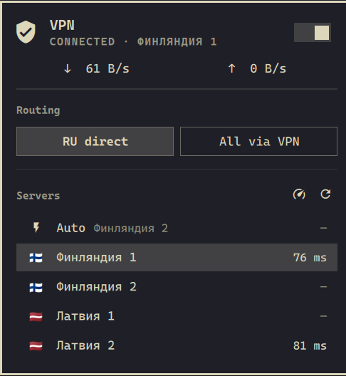

# omarchy-mihomo

A VPN bar widget for the [Omarchy](https://omarchy.org) shell, built on the
[mihomo](https://github.com/MetaCubeX/mihomo) core (Clash.Meta). It sits next
to the Wi-Fi, sound and Bluetooth widgets and works the same way: click the
shield to open the panel, right-click to turn the VPN on or off.



- **On/off switch.** It turns mihomo's TUN mode on and off, so all system
  traffic goes through the VPN with no per-app proxy settings. The last state
  is restored after a reboot.
- **Server picker.** Shows every server from your subscription with its
  latency, plus **Auto**, which uses the fastest one and shows which one it
  picked.
- **Routing.** *RU direct* sends Russian sites and IP ranges directly and
  everything else through the VPN. *All via VPN* sends everything except the
  local network through the VPN. Sites that are blocked in Russia always use
  the VPN.
- **Live traffic.** Download and upload speed while the panel is open.
- Works with any panel that serves a Clash/mihomo subscription (Remnawave,
  Marzban, 3x-ui and others) and any protocol mihomo supports (VLESS Reality,
  XHTTP, Trojan, Shadowsocks, Hysteria2…).
- The UI follows the system language (English and Russian are included).

## Requirements

- Omarchy 4.5 or newer.
- `mihomo` from the AUR: `yay -S mihomo-bin`. The package ships
  `mihomo.service`, which the installer uses.
- A subscription URL that returns a Clash/mihomo YAML config. In Remnawave
  this is the user's subscription link. Most panels pick the format from the
  client's User-Agent, and mihomo identifies itself as a mihomo client.

## Install

**1. Install mihomo**

```sh
yay -S mihomo-bin
```

**2. Add the widget to the bar**

```sh
omarchy plugin add https://github.com/aintnewtathis/omarchy-mihomo.git --enable
```

Pick where the widget goes when asked (it sits best on the right, next to the
network widget). Until step 3 is done, the panel says that mihomo is not set
up.

**3. Set up the mihomo service with your subscription**

```sh
~/.config/omarchy/plugins/aintnewtathis.mihomo/install.sh 'https://your-panel.example/sub/XXXX'
```

The script asks for your sudo password and then:

- writes `/etc/mihomo/config.yaml` from `config/config.template.yaml`, with
  your subscription URL and a random controller secret. Both are kept in
  `/etc/mihomo`, readable by root only. An existing config that it did not
  write is backed up to `config.yaml.orig`;
- checks the config with `mihomo -t`, then enables and restarts
  `mihomo.service`;
- writes `~/.config/omarchy-mihomo/controller.json`, the file the widget uses
  to talk to mihomo (address and secret, mode 600).

mihomo starts with the VPN **off**. Turn it on from the bar.

> Run only one VPN at a time. Disconnect Amnezia, WireGuard or any other VPN
> before turning this one on.

## Usage

| Action | What it does |
| --- | --- |
| Left click | Open or close the panel |
| Right click | Turn the VPN on or off |
| Middle click | Test the latency of all servers |

Keys while the panel is open: `t` VPN on/off · `a` Auto · `m` switch routing ·
`p` test latency · `u` update the subscription · `d` open the mihomo web
dashboard · `r` refresh · arrows and `Enter` move through the panel and select
· `Tab` switches to the neighbouring bar panel · `Esc` closes.

From scripts or Hyprland key bindings:

```sh
omarchy-shell aintnewtathis.mihomo on        # off, switchVpn, toggle (the panel), status
```

### Settings

```sh
omarchy bar set aintnewtathis.mihomo showLabel true         # show the server next to the icon
omarchy bar set aintnewtathis.mihomo language ru            # auto (default), en, ru
omarchy bar set aintnewtathis.mihomo refreshIntervalSec 10  # how often the panel polls mihomo
```

## How routing works

The subscription only provides the servers. Groups and rules come from
[`config/config.template.yaml`](config/config.template.yaml):

- `VPN` is the group the server picker switches (`Auto` or a fixed server).
- `RU` decides where Russian traffic goes: `DIRECT` (*RU direct*) or `VPN`
  (*All via VPN*).
- The lists come from public rule sets, and mihomo refreshes them daily by
  itself, so there is nothing to update by hand:
  - [legiz-ru/mihomo-rule-sets](https://github.com/legiz-ru/mihomo-rule-sets)
    `ru-bundle`: sites blocked in Russia or blocking Russian users, always
    through the VPN;
  - [MetaCubeX/meta-rules-dat](https://github.com/MetaCubeX/meta-rules-dat)
    `category-ru` and `geoip/ru`, plus the `.ru`, `.su` and `.рф` zones:
    Russian services, sent according to the `RU` group.
- DNS follows the same rules (fake-ip with `respect-rules`). Russian names
  resolve through Yandex DNS directly, so Russian CDNs give local answers.
  Everything else resolves through the VPN.

To change the rules, edit the template and run `install.sh` again. It keeps
the saved subscription URL and secret.

## Updating

```sh
omarchy plugin update aintnewtathis.mihomo
~/.config/omarchy/plugins/aintnewtathis.mihomo/install.sh   # only if the config template changed
```

To switch to another subscription, run `install.sh` with the new URL.

## Uninstall

```sh
omarchy plugin remove aintnewtathis.mihomo
sudo systemctl disable --now mihomo.service
sudo rm -rf /etc/mihomo ~/.config/omarchy-mihomo ~/.local/state/omarchy-mihomo
```

## Troubleshooting

- **"mihomo is not running"**: check `systemctl status mihomo` and
  `journalctl -u mihomo -n 50`. The panel's *Start mihomo* button runs
  `systemctl start mihomo.service`.
- **The servers show "–" instead of a latency**: press `p` or click the
  latency button to test them. A server that stays at "–" does not answer.
- **Sites do not load, or stall, through XHTTP servers**: mihomo opens a
  new connection for every XHTTP request unless the server sends multiplexing
  settings, and some networks throttle bursts of new connections. In
  Remnawave, add the following to each XHTTP host's *Extra* (xhttpExtraParams)
  field. The subscription then carries it to mihomo as
  `xhttp-opts.reuse-settings`:

  ```json
  {"xmux": {"maxConcurrency": "16-32", "cMaxReuseTimes": 0, "hMaxRequestTimes": "600-900", "hMaxReusableSecs": "1800-3000"}}
  ```

- **No connections at all with ufw enabled**: the template uses the `gvisor`
  TUN stack without `auto-redirect` for this reason. With the `system` or
  `mixed` stack, ufw's default-drop INPUT policy drops the tunnel's traffic.
- **Clicking another bar widget while the panel is open only closes the
  panel.** Omarchy gives third-party widgets access only to their own bar
  buttons, so the click cannot be passed on to another widget. Click again, or
  use `Tab` to move between panels.

## Development

```sh
git clone https://github.com/aintnewtathis/omarchy-mihomo.git
ln -s "$PWD/omarchy-mihomo" ~/.config/omarchy/plugins/aintnewtathis.mihomo
omarchy plugin enable aintnewtathis.mihomo
omarchy-restart-shell                       # the shell caches plugin QML; restart after edits

SUBSCRIPTION_URL='https://…' scripts/dev-run.sh   # mihomo in the foreground as a plain proxy, no TUN, no root
node --test tests/                                # parsing and formatting tests
```

| File | Purpose |
| --- | --- |
| `manifest.json` | Plugin manifest: id, bar widget entry point, settings schema |
| `Panel.qml` | Bar button and panel UI |
| `Service.qml` | Client for the mihomo REST API (state, actions, polling) |
| `Model.js`, `Strings.js` | Pure parsing and formatting helpers, UI strings |
| `config/config.template.yaml` | The mihomo config: groups, rules, DNS, TUN |
| `install.sh`, `scripts/` | Service setup, config rendering, dev run, network snapshot |

## License

[MIT](LICENSE)
